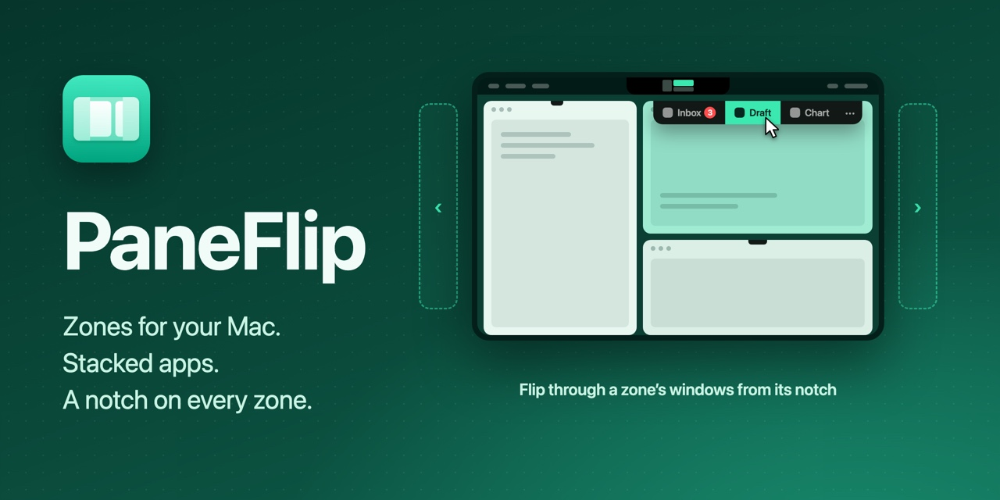

<p align="center">
  
</p>

<h3 align="center">Split your displays into zones. Drop apps into them.<br>Flip between a zone's apps from its notch or from the island in the menu bar.</h3>

<p align="center">
  <a href="../../releases/latest"></a>
  
  <a href="LICENSE"></a>
  <a href="https://crowdin.com/project/paneflipapp"></a>
</p>

<p align="center">
  <a href="#install-a-release">Install</a> ·
  <a href="#how-it-works">How it works</a> ·
  <a href="#features">Features</a> ·
  <a href="#shortcuts">Shortcuts</a> ·
  <a href="#macos-build-it-yourself">Build</a> ·
  <a href="#translations">Translations</a> ·
  <a href="https://ffferitkartalll.github.io/paneflipapp/">Website</a>
</p>

PaneFlip is a native macOS menu-bar app (Swift, SwiftUI, Liquid Glass). It lays your screens out in zones that you draw,
puts each app where it belongs, and lets several apps share one zone: the zone's notch and the island in the menu bar
switch between them. Your layouts and settings stay on your Mac, and the app is free and open source.

## How it works

1. **Snap.** Drag a window while you hold <kbd>⌃</kbd><kbd>⌥</kbd>: the zones light up. Let go over one and the window
   slides in and fills it. Or press <kbd>⌃</kbd><kbd>⌥</kbd><kbd>M</kbd> and choose a zone with the arrow keys. Apps you put
   in a zone are remembered, and come back to it when they reopen.
2. **Stack and flip.** Put more apps in the same zone and they stack. Point at the zone's notch, at its top edge, and it shows a
   part for each window; scroll over it, press <kbd>⌃</kbd><kbd>⌥</kbd><kbd>←</kbd> / <kbd>→</kbd>, or click a card of its row. The
   next window glides in beside the one it replaces.
3. **Go beyond the screen.** A layout can go on past the edges of the display, as many screens as you like. Press
   <kbd>⌃</kbd><kbd>⌥</kbd><kbd>⌘</kbd><kbd>←</kbd> / <kbd>→</kbd>, scroll over the island in the menu bar, or swipe, and the whole
   layout slides over.

## Features

**Layouts and the editor**
- Draw a layout in the editor: click to split a zone (hold <kbd>⇧</kbd> to split it across), drag a line to resize (it sticks at
  ¼, ⅓, ½, ⅔ and ¾), double-click a handle to remove the line, drag a zone onto its neighbour to merge them. Undo and redo.
- **Grid** makes a grid of equal zones: move the Rows and Columns sliders and watch it, then Apply. Or start from one of 21
  common shapes, or from a blank layout.
- **Spacing** sets, for each layout, the gap between the zones, the margin at the screen's edges and the smallest a zone may be.
  Zones of equal shares are equally large, with a gap or without.
- Keep a zone at an aspect ratio (1:1, 4:3, 3:2, 16:10, 16:9, 21:9, or standing up): when a line moves, the zone's other lines
  move with it, in the editor and on the desktop.
- Star a default zone, name your layouts and zones, duplicate, export and import a layout.
- A layout belongs to a display, and every desktop of that display uses the layout you choose for it. Switch layouts from
  the menu bar.
- Move the lines between the zones on the desktop itself: press <kbd>⌃</kbd><kbd>⌥</kbd> twice quickly, drag a handle, then
  Done or <kbd>esc</kbd>.

**Putting windows in zones**
- Hold <kbd>⌃</kbd><kbd>⌥</kbd> while you drag a window, and let go over a zone; or drop it on a zone of the island.
- Press <kbd>⌃</kbd><kbd>⌥</kbd><kbd>M</kbd> to send the focused window to a zone of any display: the arrow keys choose in the
  island, <kbd>↩</kbd> places, <kbd>⌫</kbd> takes it out of its zone, <kbd>esc</kbd> cancels.
- A window dragged out of its zone glides back to the size it had before.
- Undo the last action on a window with <kbd>⌃</kbd><kbd>⌥</kbd><kbd>⌫</kbd>: the island says what happened, with an Undo
  button, for ten seconds. <kbd>⌃</kbd><kbd>⌥</kbd><kbd>esc</kbd> closes the message.
- Apps you never want in a zone go on the list of ignored apps.

**Stacks, notches and the island**
- Every zone that holds a window has a notch at its top edge. Point at it and it grows, cut into a part for each window; click it
  for a row of the windows, drag their cards into another order, or press the "more" button for the cards of the island.
  Scroll over it to flip.
- Flip only in the zone with the focus: <kbd>⌃</kbd><kbd>⌥</kbd><kbd>←</kbd> / <kbd>→</kbd>, hold <kbd>⌃</kbd><kbd>⌥</kbd> and
  scroll, or swipe on the trackpad. The windows follow your fingers and settle on the nearest one.
- Move the focus to the zone above, on the left, below or on the right with <kbd>⌃</kbd><kbd>⌥</kbd><kbd>I</kbd> / <kbd>J</kbd> /
  <kbd>K</kbd> / <kbd>L</kbd>, on to the next display too.
- Enlarge the focused window to the whole screen for fifteen seconds with <kbd>⌃</kbd><kbd>⌥</kbd><kbd>↩</kbd>, or a double click
  on the front card of the island; it goes back to its zone when the time is up.
- Point at the island in the menu bar and it opens: your zones drawn small, and buttons to edit the layout, open the selected
  apps, Settings and Quit. Click a zone for its windows as cards: quit, close, hide, minimize or take a window out of its zone,
  tick the apps to open with the layout, see the Dock's notification badges, drag a card to another zone.

**Screens beyond the screen**
- Any number of screens beyond each edge, one after the other, reached with the shortcuts, with the wheel or two fingers over
  the island, or on the trackpad, by your choice: two fingers with the keys held, or four fingers (three for a zone's windows).
  The layout comes to rest at each screen. A window that gets the focus there brings its screen into view.

**Everywhere**
- Several displays and desktops. Set where the displays stand on your desk, and the moves and the pointer go from one to the
  next as they stand. Unplug a display and its windows spread over the others; plug it in and they go back to their zones.
- Closed, hidden and minimized windows leave their zone and return when they do.
- Caps Lock can be a modifier key: every shortcut then has a one-key version on <kbd>⇪</kbd>.
- Launch at login, one switch that turns everything off, updates from inside the app or with Homebrew, 46 languages.

## Shortcuts

Every shortcut can be changed in `Settings ▸ Shortcuts`. With Caps Lock as a modifier key (a setting there) the standard
ones are built on <kbd>⇪</kbd> instead.

| | Default | With Caps Lock |
|---|---|---|
| Put a window in a zone | hold <kbd>⌃</kbd><kbd>⌥</kbd> while dragging | hold <kbd>⇪</kbd> while dragging |
| Send the focused window to a zone | <kbd>⌃</kbd><kbd>⌥</kbd><kbd>M</kbd>, then the arrow keys, <kbd>↩</kbd> to place, <kbd>⌫</kbd> to take it out of its zone, <kbd>esc</kbd> to cancel | <kbd>⇪</kbd><kbd>M</kbd> |
| Next / previous window of the zone | <kbd>⌃</kbd><kbd>⌥</kbd><kbd>→</kbd> / <kbd>←</kbd> | <kbd>⇪</kbd><kbd>→</kbd> / <kbd>←</kbd> |
| Move through a zone's windows | hold <kbd>⌃</kbd><kbd>⌥</kbd> and scroll over the zone | hold <kbd>⇪</kbd> and scroll |
| Enlarge the focused window for 15 seconds | <kbd>⌃</kbd><kbd>⌥</kbd><kbd>↩</kbd> | <kbd>⇪</kbd><kbd>↩</kbd> |
| Move the focus to the zone above / left / below / right | <kbd>⌃</kbd><kbd>⌥</kbd><kbd>I</kbd> / <kbd>J</kbd> / <kbd>K</kbd> / <kbd>L</kbd> | <kbd>⇪</kbd><kbd>I</kbd> / <kbd>J</kbd> / <kbd>K</kbd> / <kbd>L</kbd> |
| Undo the last window action | <kbd>⌃</kbd><kbd>⌥</kbd><kbd>⌫</kbd> | <kbd>⇪</kbd><kbd>⌫</kbd> |
| Close the undo message | <kbd>⌃</kbd><kbd>⌥</kbd><kbd>esc</kbd> | <kbd>⇪</kbd><kbd>esc</kbd> |
| Scroll to the screen beyond the right / left edge | <kbd>⌃</kbd><kbd>⌥</kbd><kbd>⌘</kbd><kbd>→</kbd> / <kbd>←</kbd> | <kbd>⇪</kbd><kbd>⇧</kbd><kbd>→</kbd> / <kbd>←</kbd> |
| Slide to the screens beyond the edges | hold <kbd>⌃</kbd><kbd>⌥</kbd><kbd>⌘</kbd> and scroll | hold <kbd>⇪</kbd><kbd>⇧</kbd> and scroll |
| Move the lines between the zones | press <kbd>⌃</kbd><kbd>⌥</kbd> twice quickly | press <kbd>⇪</kbd> twice quickly |

On the trackpad (`Settings ▸ Trackpad`): two fingers with the keys held, or, with no keys, three fingers for a zone's windows
and four for the screens beyond the edges. Over the open island, or over a zone's notch, the wheel and two fingers need no keys.

## Install a release

### From a download

Download the `.dmg` of the latest [release](../../releases), open it and drag PaneFlip into Applications. The app is
signed with a certificate of its own, not an Apple developer one, so macOS does not recognise it: the first time, open
it, then choose `System Settings ▸ Privacy & Security ▸ Open Anyway`. The first launch asks for the Accessibility and
Screen Recording permissions.

Or take the quarantine mark off in Terminal instead:

```bash
xattr -dr com.apple.quarantine /Applications/PaneFlip.app
```

### With Homebrew

Install it with [Homebrew](https://brew.sh):

```bash
brew install --cask ffferitkartalll/tap/paneflipapp
```

Homebrew removes the quarantine mark, so the first-open step above is not needed. `Settings ▸ Updates` tells you when a
newer release exists and how to get it.

## Permissions

PaneFlip asks for two permissions on the first launch, and tells you why:

- **Accessibility**, to see the windows of other apps and move them into zones.
- **Screen Recording**, to take a picture of a window, so it can slide in beside another one inside its zone. The pictures
  stay in memory for a few minutes; nothing is recorded, saved or sent.

## macOS (build it yourself)

Requires macOS 27, Xcode 27 (Swift 6.4) and [XcodeGen](https://github.com/yonaskolb/XcodeGen)
(`brew install xcodegen`).

### 1. Go to the macOS folder

```bash
cd macos
```

### 2. Copy the build settings

Then set your own bundle identifier in the new file (see below).

```bash
cp Config/Local.xcconfig.example Config/Local.xcconfig
```

### 3. Make a local signing certificate

Once per Mac (see below for why).

```bash
./scripts/setup-local-signing.sh
```

### 4. Create the Xcode project

It is made from `project.yml`.

```bash
xcodegen generate
```

### 5. Open it and run

Run the PaneFlip scheme on "My Mac".

```bash
open PaneFlip.xcodeproj
```

**Use your own bundle identifier.** `Config/Local.xcconfig` (ignored by git) holds `PANEFLIP_BUNDLE_ID`; the
example file has a placeholder. macOS ties the permissions the app is given, and its saved settings, to the
bundle identifier, so choose one that belongs to you (reverse-DNS, for example `com.yourname.paneflip`) and keep
using it.
A debug build is a separate app, **PaneFlip Debug**, with the identifier plus `.debug`, so its permissions and
settings never mix with those of a release (`PaneFlip`); grant the permissions to it once.

**Why the signing step:** macOS ties the Accessibility permission to the app's code signature. Ad-hoc signed
debug builds get a new signature on every build, so the permission would be asked for again each time. The script
creates a self-signed certificate in your login keychain (macOS asks for your password once to trust it); every
build is then signed with it and the permission is kept. With an Apple developer account, set `DEVELOPMENT_TEAM`
and your identity in `project.yml` instead.

If you delete and recreate the certificate, quit and reopen Xcode afterwards: a running Xcode remembers the
old certificate and fails with `no identity found` until it is restarted.

### Run the tests

The domain module and its tests build without Xcode. From the `macos` folder:

```bash
swift test
```

The app is an agent app (menu bar only, no Dock icon). The first launch asks for the Accessibility permission.

- [`macos/ARCHITECTURE.md`](macos/ARCHITECTURE.md): layers, folders, responsibilities.
- [`CONTRIBUTING.md`](CONTRIBUTING.md): how changes are made.

## Good to know

- **Not for the Mac App Store.** To move other apps' windows PaneFlip needs the Accessibility permission and runs
  without the App Sandbox, and it uses some undocumented system interfaces (private CoreGraphics Services calls
  for desktops and the cursor). A system update can change them.
- **Brand icons.** When an app has no system symbol, PaneFlip can fetch a one-colour brand icon from the
  [Simple Icons](https://simpleicons.org) set through the jsDelivr CDN (`Settings ▸ Stacking ▸ Fetch brand
  icons`, on by default; the names of the apps in your zones are sent to the host, nothing else). Trademarks and
  logos belong to their owners. Turn it off and nothing is looked up.
- **No data leaves your Mac** otherwise (the one request that is not about your zones: `Settings ▸ Updates ▸ Check now` asks GitHub for the newest release): layouts, memory and settings are local files and preferences.

## Translations

The app's texts are in `macos/Sources/PaneFlip/Resources/Localizable.xcstrings`, and a language is added by
translating that catalog: no code changes. Translations are made in the public Crowdin project
**[PaneFlip on Crowdin](https://crowdin.com/project/paneflipapp)**: pick your language (or ask for a new one),
translate there, and Crowdin sends a pull request with the result. You can also edit the catalog directly in a
pull request. A language appears in `Settings ▸ General ▸ Language` as soon as the catalog has it.

## Contributing and security

Issues and pull requests are welcome; see [CONTRIBUTING.md](CONTRIBUTING.md). Report a security problem as
described in [SECURITY.md](SECURITY.md), not in a public issue.

## Platforms

One repository, one folder per platform.

| Platform | Folder | Status |
|---|---|---|
| macOS | [`macos/`](macos/) | Working |
| Windows | `windows/` | Not started |
| Linux | `linux/` | Not started |

Each platform is a self-contained project with its own build, tests and architecture notes, and uses the
platform's native UI and window APIs. Start from the platform's own README or `ARCHITECTURE.md`.

## Adding a platform

Create a new top-level folder (`windows/`, `linux/`, …). Keep platform code inside it; do not share source files
across platforms. Product behaviour that should stay identical (how zones, stacks and the island behave) is the
reference in `macos/ARCHITECTURE.md` and the unit tests of `macos/Sources/PaneFlipCore`.

## License

[MIT](LICENSE).
