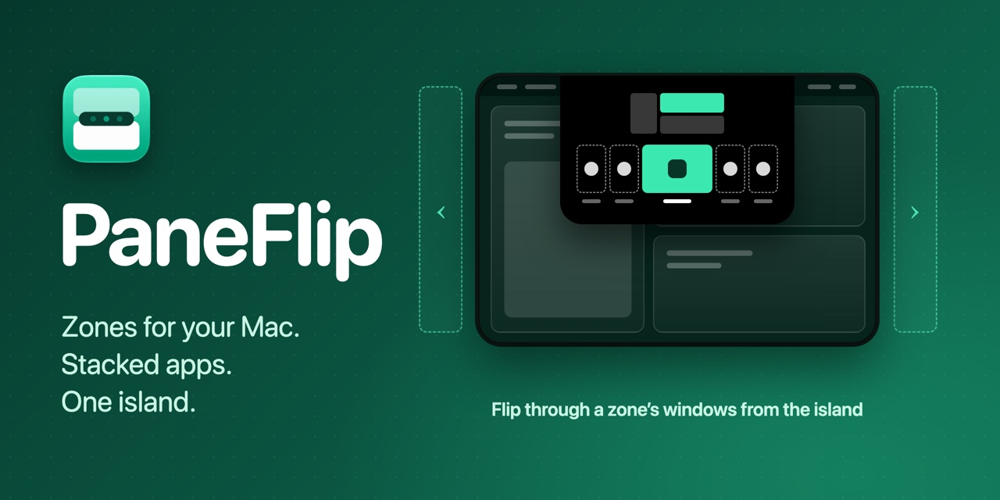

<p align="center">
  
</p>

<h3 align="center">Split your displays into zones. Drop apps into them.<br>Flip between a zone's apps with one glass pill.</h3>

<p align="center">
  <a href="../../releases/latest"></a>
  
  <a href="LICENSE"></a>
  <a href="https://crowdin.com/project/paneflipapp"></a>
</p>

<p align="center">
  <a href="#install-a-release">Install</a> ·
  <a href="#quick-look">Quick look</a> ·
  <a href="#how-it-works">How it works</a> ·
  <a href="#features">Features</a> ·
  <a href="#shortcuts">Shortcuts</a> ·
  <a href="#macos-build-it-yourself">Build</a> ·
  <a href="#translations">Translations</a>
</p>

PaneFlip is a native macOS menu-bar app (Swift, SwiftUI, Liquid Glass). It lays your screens out in zones that you draw,
puts each app where it belongs, and lets several apps share one zone: a small glass pill over the zone switches between
them. Your layouts and settings stay on your Mac, and the app is free and open source.

## Quick look

https://github.com/user-attachments/assets/5aad76fa-2026-4a2f-8ac1-4af6b928c75a

## How it works

1. **Snap.** Drag a window while you hold <kbd>⌘</kbd> (the left one): the zones light up. Let go over one and the window
   slides in and fills it. Apps you put in a zone are remembered, and come back to it when they reopen.
2. **Stack and flip.** Put more apps in the same zone and they stack. Point at the zone and the glass pill appears:
   click an app, scroll over the pill, or press <kbd>⌃</kbd><kbd>⌥</kbd><kbd>←</kbd> / <kbd>→</kbd> to flip. The next
   window glides in beside the one it replaces.
3. **Go beyond the screen.** A layout can go on past the edge of the display, as many zones as you like. Scroll with the
   wheel or two fingers over the island in the menu bar, or press <kbd>⌃</kbd><kbd>⌥</kbd><kbd>⌘</kbd><kbd>←</kbd> / <kbd>→</kbd>, and the whole layout slides over.

## Features

**Layouts**
- Draw a layout in the editor: click to split a zone, drag a line to resize, drag a zone onto its neighbour to merge. A plus at an edge
  adds a whole screen there; scroll to it and draw it at full size, with a small map showing where you are.
- Start from one of twenty common shapes (columns, rows, grids, a main zone with side zones, banners) or from a blank
  layout that opens in the editor at once. Name your layouts and your zones, duplicate a layout, set a gap per layout.
- A layout belongs to a display, and every desktop of that display uses the layout you choose for it. Switch layouts from
  the menu bar.
- A margin runs round the edges of the screen, and a gap between the zones.

**Zones beyond the screen**
- Any number of areas beyond each edge, one after the other, reached with the shortcuts, with the wheel or two fingers over the island in the
  menu bar, or on the trackpad, by your choice: four fingers, or two fingers with the keys held. The layout stops at every vertical line between zones, on the screen and beyond it, so each
  step brings the next zone in. A window that gets the focus there brings its zone into view by itself.

**Stacks and the pill**
- The pill shows the apps of a zone as icons, names or both, along the top or the bottom of the zone, always or only when
  you point at it. Double-tap <kbd>⌘</kbd> to move it out of the way.
- Choose which app opens in which zone, in what order the pill shows them, and open the ones you tick with one click, from
  the layout or from the menu bar. Apps you never want in a zone go on the list of ignored apps.
- A window dragged out of its zone glides back to the size it had before.

**Everywhere**
- Several displays and desktops. Unplug a display and its apps move to the default zone of the main screen; plug it in and
  they go back.
- Closed, hidden and minimized windows leave their zone and return when they do.
- Updates from inside the app, or with Homebrew. 46 languages.

## Shortcuts

| | Default | |
|---|---|---|
| Snap a window into a zone | hold <kbd>⌘</kbd> (left) while dragging | changeable |
| Hide the pill under the pointer | double-tap <kbd>⌘</kbd> (left) | changeable |
| Next / previous window of the zone | <kbd>⌃</kbd><kbd>⌥</kbd><kbd>→</kbd> / <kbd>←</kbd> | changeable |
| Scroll to the zones beyond the right / left edge | <kbd>⌃</kbd><kbd>⌥</kbd><kbd>⌘</kbd><kbd>→</kbd> / <kbd>←</kbd> | changeable |

All of them are set in `Settings ▸ Shortcuts`.

## Install a release

### From a download

Download the `.dmg` of the latest [release](../../releases), open it and drag PaneFlip into Applications. The app is
signed with a certificate of its own, not an Apple developer one, so macOS does not recognise it: the first time, open
it, then choose `System Settings ▸ Privacy & Security ▸ Open Anyway`. The first launch asks for the Accessibility and
Screen Recording permissions.

Or take the quarantine mark off in Terminal instead:

```bash
xattr -dr com.apple.quarantine /Applications/PaneFlip.app
```

### With Homebrew

Install it with [Homebrew](https://brew.sh):

```bash
brew install --cask ffferitkartalll/tap/paneflipapp
```

Homebrew removes the quarantine mark, so the first-open step above is not needed. `Settings ▸ Updates` tells you when a
newer release exists and how to get it.

## Permissions

PaneFlip asks for two permissions on the first launch, and tells you why:

- **Accessibility**, to see the windows of other apps and move them into zones.
- **Screen Recording**, to take a picture of a window, so it can slide in beside another one inside its zone. The pictures
  stay in memory for a few minutes; nothing is recorded, saved or sent.

## macOS (build it yourself)

Requires macOS 27, Xcode 27 (Swift 6.4) and [XcodeGen](https://github.com/yonaskolb/XcodeGen)
(`brew install xcodegen`).

### 1. Go to the macOS folder

```bash
cd macos
```

### 2. Copy the build settings

Then set your own bundle identifier in the new file (see below).

```bash
cp Config/Local.xcconfig.example Config/Local.xcconfig
```

### 3. Make a local signing certificate

Once per Mac (see below for why).

```bash
./scripts/setup-local-signing.sh
```

### 4. Create the Xcode project

It is made from `project.yml`.

```bash
xcodegen generate
```

### 5. Open it and run

Run the PaneFlip scheme on "My Mac".

```bash
open PaneFlip.xcodeproj
```

**Use your own bundle identifier.** `Config/Local.xcconfig` (ignored by git) holds `PANEFLIP_BUNDLE_ID`; the
example file has a placeholder. macOS ties the permissions the app is given, and its saved settings, to the
bundle identifier, so choose one that belongs to you (reverse-DNS, for example `com.yourname.paneflip`) and keep
using it.
A debug build is a separate app, **PaneFlip Debug**, with the identifier plus `.debug`, so its permissions and
settings never mix with those of a release (`PaneFlip`); grant the permissions to it once.

**Why the signing step:** macOS ties the Accessibility permission to the app's code signature. Ad-hoc signed
debug builds get a new signature on every build, so the permission would be asked for again each time. The script
creates a self-signed certificate in your login keychain (macOS asks for your password once to trust it); every
build is then signed with it and the permission is kept. With an Apple developer account, set `DEVELOPMENT_TEAM`
and your identity in `project.yml` instead.

If you delete and recreate the certificate, quit and reopen Xcode afterwards: a running Xcode remembers the
old certificate and fails with `no identity found` until it is restarted.

### Run the tests

The domain module and its tests build without Xcode. From the `macos` folder:

```bash
swift test
```

The app is an agent app (menu bar only, no Dock icon). The first launch asks for the Accessibility permission.

- [`macos/ARCHITECTURE.md`](macos/ARCHITECTURE.md): layers, folders, responsibilities.
- [`CONTRIBUTING.md`](CONTRIBUTING.md): how changes are made.

## Good to know

- **Not for the Mac App Store.** To move other apps' windows PaneFlip needs the Accessibility permission and runs
  without the App Sandbox, and it uses some undocumented system interfaces (private CoreGraphics Services calls
  for desktops and the cursor, private AppKit selectors for the pill's look). A system update can change them; the
  app then falls back to a plainer look instead of failing.
- **Brand icons.** When an app has no system symbol, PaneFlip can fetch a one-colour brand icon from the
  [Simple Icons](https://simpleicons.org) set through the jsDelivr CDN (`Settings ▸ Stacking ▸ Fetch brand
  icons`, on by default; the names of the apps in your zones are sent to the host, nothing else). Trademarks and
  logos belong to their owners. Turn it off and nothing is looked up.
- **No data leaves your Mac** otherwise (the one request that is not about your zones: `Settings ▸ Updates ▸ Check now` asks GitHub for the newest release): layouts, memory and settings are local files and preferences.

## Translations

The app's texts are in `macos/Sources/PaneFlip/Resources/Localizable.xcstrings`, and a language is added by
translating that catalog: no code changes. Translations are made in the public Crowdin project
**[PaneFlip on Crowdin](https://crowdin.com/project/paneflipapp)**: pick your language (or ask for a new one),
translate there, and Crowdin sends a pull request with the result. You can also edit the catalog directly in a
pull request. A language appears in `Settings ▸ General ▸ Language` as soon as the catalog has it.

## Contributing and security

Issues and pull requests are welcome; see [CONTRIBUTING.md](CONTRIBUTING.md). Report a security problem as
described in [SECURITY.md](SECURITY.md), not in a public issue.

## Platforms

One repository, one folder per platform.

| Platform | Folder | Status |
|---|---|---|
| macOS | [`macos/`](macos/) | Working |
| Windows | `windows/` | Not started |
| Linux | `linux/` | Not started |

Each platform is a self-contained project with its own build, tests and architecture notes, and uses the
platform's native UI and window APIs. Start from the platform's own README or `ARCHITECTURE.md`.

## Adding a platform

Create a new top-level folder (`windows/`, `linux/`, …). Keep platform code inside it; do not share source files
across platforms. Product behaviour that should stay identical (how zones, stacks and the pill behave) is the
reference in `macos/ARCHITECTURE.md` and the unit tests of `macos/Sources/PaneFlipCore`.

## License

[MIT](LICENSE).
